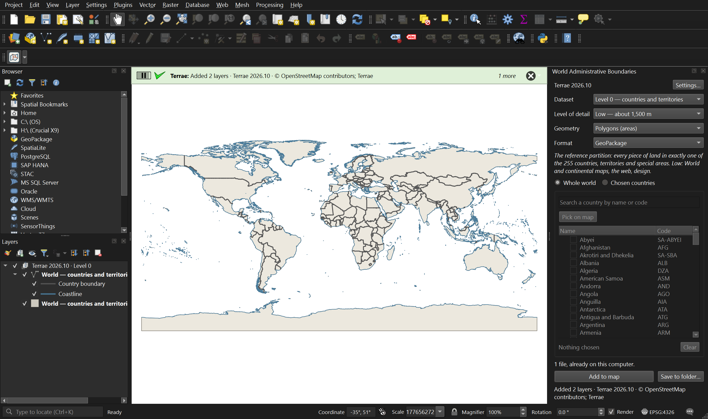
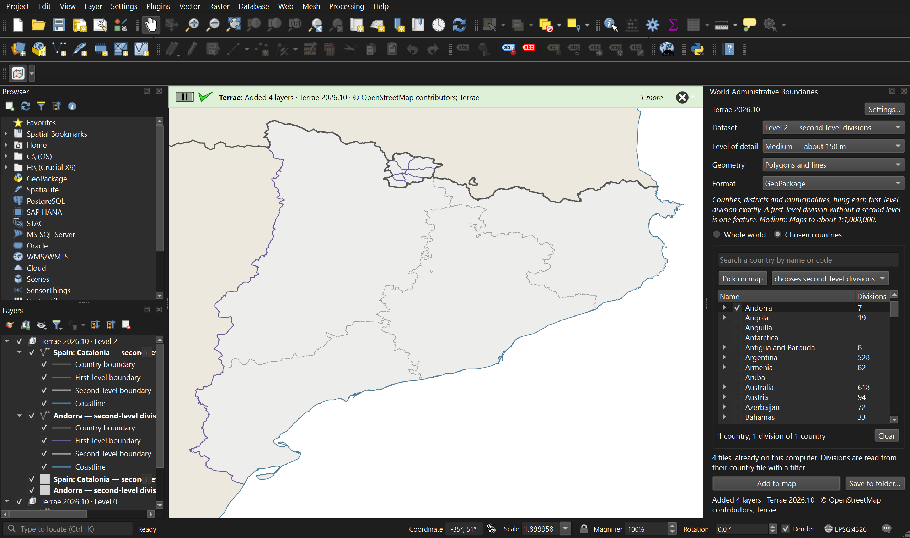
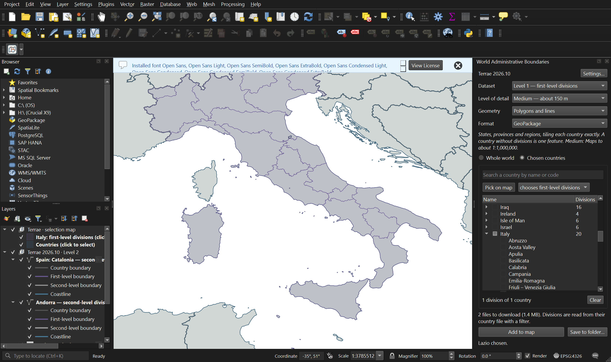

# World Administrative Boundaries

A QGIS plugin that adds the administrative boundaries of the whole world to your project in a few clicks:
**countries and territories (ADM0)** and each country's **first- and second-level administrative divisions (ADM1,
ADM2)**, as polygons or as boundary lines with borders and coastlines. Take the whole world, or only the countries
and divisions you choose.

The divisions follow each country's own administrative structure: states and counties in the United States,
autonomous communities and provinces in Spain, regions and departments in France.

- **Three levels that fit one another exactly**: 255 countries and territories, 3,907 first-level divisions and
  50,231 second-level features.
- **Polygons or lines**: lines are classified as international border, internal boundary or coastline, so borders
  can be drawn without coasts.
- **Four levels of detail**: from the native geometry of OpenStreetMap to about 15 m, 150 m and 1,500 m, for
  anything from large-scale maps to world maps.
- **Only what you ask for is downloaded**: one country is one small file; a single province is read from the file
  of its country.
- **Choose in a list, by search, or by clicking on the map**, drilling down from a country to its divisions.
- **Works offline afterwards**: downloads are verified against checksums and kept; a local copy of the data
  repository can be used instead of the online one.
- QGIS 3.28 or later and QGIS 4 (Qt 5 and Qt 6).

## Screenshots

Chosen divisions: Catalonia with its second-level divisions, as polygons and lines.

Picking on the map: click a country, then its divisions.

## Install

In QGIS: **Plugins ▸ Manage and Install Plugins…**, search for *World Administrative Boundaries* and install it
(once the plugin is listed in the QGIS plugin repository).

Or download `world_admin_boundaries-<version>.zip` from the
[releases](https://github.com/p-rubi/world-administrative-boundaries/releases) of this repository and use
**Plugins ▸ Manage and Install Plugins… ▸ Install from ZIP**.

A toolbar button and an entry in the **Web** menu open the panel. The guide is
[world_admin_boundaries/README.md](world_admin_boundaries/README.md), also under *Help* in the plugin's menu.

## The data: Terrae

The boundaries are **[Terrae](https://github.com/p-rubi/terrae)**, an open dataset by the same author, built from
one snapshot of OpenStreetMap as a single partition of the world's land: every point of land is in exactly one
country, one first-level division and one second-level feature, and the three levels share their edges. How it is
made, its rules for disputed land and its limitations are described in the
[Terrae methodology](https://github.com/p-rubi/terrae/blob/main/docs/methodology.md).

The plugin downloads the files from Terrae's public data repository; `data-source.json` in this repository says
where that is.

## Licence and credit

- The plugin: GNU General Public License, version 2 or later ([LICENSE](LICENSE)).
- The data: Open Database License 1.0. Credit **© OpenStreetMap contributors; Terrae** on maps and works made with
  it; an adapted database must be shared under the same licence.

Boundaries and names shown do not imply any opinion on the legal status of any country, territory or area.

## Contact

Made by [p-rubi](https://github.com/p-rubi). Bugs and suggestions: the
[issue tracker](https://github.com/p-rubi/world-administrative-boundaries/issues), or geo.prubi@gmail.com.